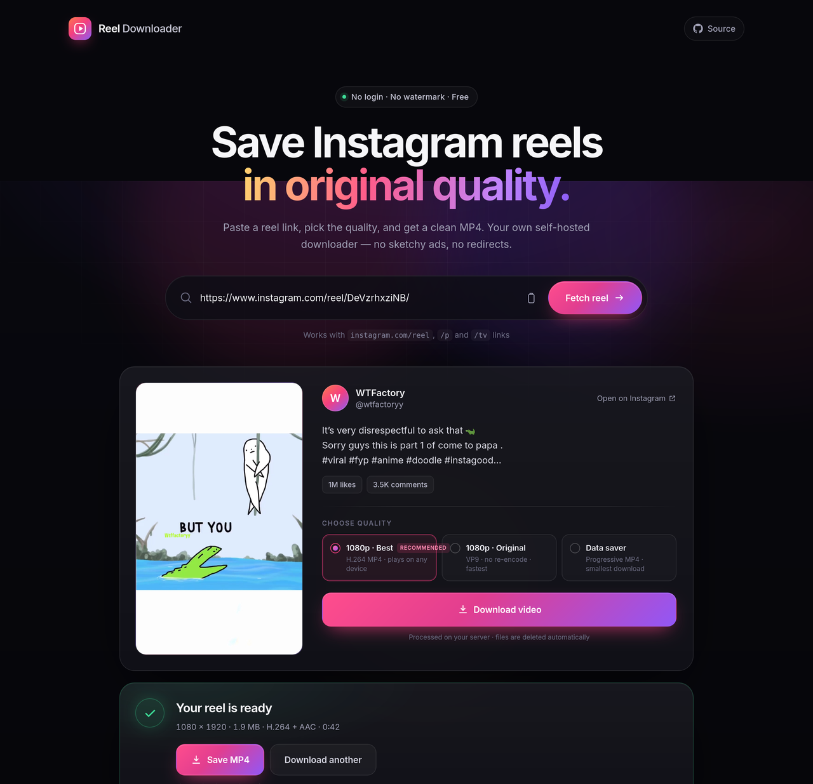
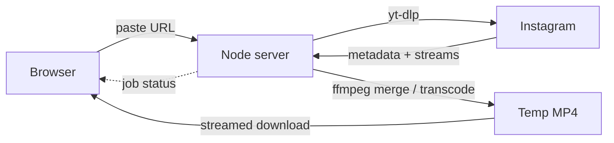

# Instagram Reel Downloader - Download Instagram Videos, Reels &amp; Photos Free

**Paste an Instagram reel link → pick a quality → save a clean MP4.**

A self-hosted Instagram video downloader with a polished web UI, a zero-dependency Node backend, and a CLI. It uses [yt-dlp](https://github.com/yt-dlp/yt-dlp) to extract the best available streams and FFmpeg to deliver a universally playable H.264 MP4. Download Instagram reels, videos, photos, IGTV, profile pictures and stories in HD and 4K quality — no login, no watermark, 100% free.

[](https://nodejs.org)
[](LICENSE)
[](#why-no-npm-install)



---

## Features

- **Download video from Instagram** — reels, videos, IGTV, posts, stories, and profile pictures.
- **Instagram video downloader** — resolves DASH streams Instagram serves, up to 1080×1920.
- **Universal H.264 output** — VP9 sources converted to H.264/AAC so the file plays on iPhone, Android, QuickTime, and every browser.
- **Three quality modes** — Best (H.264), Original (no re-encode, fastest), and Data saver (progressive MP4).
- **Paste anything** — reel URLs, `/p/` posts, `/tv/` links, `instagram.com/share/...` links, mobile links, or a whole share message.
- **Live progress + cancel** — server-side job queue, real progress, and one-click cancellation.
- **No login, no watermark, no database** — nothing about your reels is persisted. Temp files are deleted after 30 minutes.
- **SSRF-safe URL allowlist** and per-IP rate limiting.
- **CLI included** — scriptable downloads without opening a browser.
- **Docker + Render blueprint** — deploy a long-running container in minutes.
- **Zero npm runtime dependencies** — only Node built-ins; no `npm install` needed.

## Quick start

### Requirements

| Tool | Version | Why |
| --- | --- | --- |
| [Node.js](https://nodejs.org) | 20+ | Web server and job queue |
| [yt-dlp](https://github.com/yt-dlp/yt-dlp) | recent | Instagram extraction |
| [FFmpeg](https://ffmpeg.org) | 6+ | merge / transcode to MP4 |

Install the binaries:

```bash
# macOS
brew install yt-dlp ffmpeg

# Debian / Ubuntu
sudo apt update && sudo apt install -y ffmpeg python3-pip
python3 -m pip install -U yt-dlp

# Windows (PowerShell)
winget install yt-dlp.yt-dlp Gyan.FFmpeg
```

### Run it

```bash
git clone https://github.com/Shakeel5692/reel-downloader.git
cd reel-downloader
npm start
```

Open **http://localhost:3000**, paste a reel link, and download.

> There is nothing to `npm install` — the server uses only Node's standard library. `npm test` runs the built-in test suite.

Optional: copy the example config (loaded automatically by `npm start`):

```bash
cp .env.example .env
```

### Docker

```bash
docker build -t reel-downloader .
docker run --rm -p 3000:3000 --name reel-downloader reel-downloader
```

With a cookie file mounted read-only:

```bash
docker run --rm -p 3000:3000 \
  -e COOKIES_FILE=/cookies.txt \
  -v "$PWD/cookies.txt:/cookies.txt:ro" \
  reel-downloader
```

### Deploy to Render

The repo includes a [`render.yaml`](render.yaml) blueprint:

1. Push the repo to GitHub.
2. In Render: **New → Blueprint**, select this repo, and apply.
3. Use the generated URL.

**Important:** Instagram often blocks datacenter IP ranges. If Render works when you test it and then starts returning “login required”, add cookies (see below), or run the app on your own machine/residential connection. This app needs a long-running container with a writable temp directory; it is not a good fit for short-lived serverless functions.

## CLI

```bash
# Best quality (H.264)
node cli.js "https://www.instagram.com/reel/DeVzrhxziNB/"

# Original stream, no re-encode
node cli.js "https://www.instagram.com/reel/DeVzrhxziNB/" -q source -o ~/Videos

# Data saver
node cli.js "https://www.instagram.com/reel/DeVzrhxziNB/" -q fast

# Optional global command
npm link
reel-downloader "https://www.instagram.com/reel/DeVzrhxziNB/"
```

```
$ node cli.js "https://www.instagram.com/reel/DeVzrhxziNB/"
Fetching reel details…
@wtfactoryy — It’s very disrespectful to ask that 🐊
Downloading (best)…
Saved /home/you/wtfactoryy-DeVzrhxziNB-1080p.mp4
  1080×1920 · 1.9 MB · H.264 + AAC
```

## How it works



1. The server validates the URL against a strict `instagram.com` allowlist.
2. `yt-dlp --dump-single-json` resolves metadata and all available formats.
3. The download job selects the best video + audio streams, merges them with FFmpeg, and converts VP9/AV1 to H.264 when needed.
4. The finished MP4 is kept in a private temp directory and streamed to your browser with `Content-Disposition: attachment`.
5. Jobs and files expire automatically after 30 minutes.

### Quality modes

| Mode | Streams | Processing | Best for |
| --- | --- | --- | --- |
| **Best** `best` | best video + best audio | H.264/AAC transcode if the source is VP9/AV1 | Sharing, editing, iPhone playback |
| **Original** `source` | best video + best audio | remux only (no quality loss) | Archiving, fastest 1080p |
| **Data saver** `fast` | progressive MP4 | remux only | Small files / quick downloads |

The sample reel resolves to **1080×1920 VP9**, so the Best mode produces a **1080×1920 H.264/AAC MP4** (~2 MB for 42 seconds) in roughly 10–15 seconds.

## Configuration

All settings are optional environment variables. `npm start` also loads a local `.env` file automatically (see [`.env.example`](.env.example)); existing environment variables always win.

| Variable | Default | Description |
| --- | --- | --- |
| `PORT` | `3000` | HTTP port |
| `HOST` | `0.0.0.0` | Bind address |
| `MAX_CONCURRENT` | `2` | Simultaneous downloads |
| `MAX_QUEUED` | `40` | Waiting jobs before returning 429 |
| `JOB_TTL_MIN` | `30` | Minutes to keep a finished MP4 |
| `RESOLVE_TTL_MIN` | `10` | Metadata/thumbnail cache TTL |
| `TMP_DIR` | `<os tmp>/reel-downloader` | Working directory (cleared on startup) |
| `YTDLP_PATH` | `yt-dlp` | Custom yt-dlp binary |
| `FFMPEG_PATH` | `ffmpeg` | Custom ffmpeg binary |
| `FFPROBE_PATH` | derived | Custom ffprobe binary |
| `COOKIES_FILE` | — | Netscape cookie file for authenticated requests |
| `INSTAGRAM_COOKIES_B64` | — | Base64-encoded cookie file (good for PaaS env vars) |
| `TRUST_PROXY` | — | Set to `1` behind a reverse proxy to rate-limit by `X-Forwarded-For` |
| `DOWNLOAD_TIMEOUT_MS` | `600000` | Hard timeout per download |

Example:

```bash
PORT=8080 MAX_CONCURRENT=3 JOB_TTL_MIN=15 npm start
```

## Cookies (when Instagram says “login required”)

Public reels usually work without any login. Instagram can still require authentication for some content or block an IP. Export cookies from a logged-in browser in **Netscape** format using a cookie-export extension, then either:

```bash
# Option A: point to the file
COOKIES_FILE=/secure/path/cookies.txt npm start
```

```bash
# Option B: base64 for a PaaS environment variable
base64 -w0 cookies.txt        # Linux
base64 -i cookies.txt | tr -d '\n'   # macOS
```

Set `INSTAGRAM_COOKIES_B64` to the output. Treat cookies as passwords — the file is git-ignored, and `INSTAGRAM_COOKIES_B64` is written to a `0600` temp file at runtime.

## API

All endpoints are JSON unless noted. URLs must live on `instagram.com`.

### `POST /api/resolve`

```bash
curl -s http://localhost:3000/api/resolve \
  -H 'content-type: application/json' \
  -d '{"url":"https://www.instagram.com/reel/DeVzrhxziNB/"}'
```

Returns metadata, available qualities, and a proxied thumbnail URL:

```json
{
  "reel": {
    "shortcode": "DeVzrhxziNB",
    "authorHandle": "wtfactoryy",
    "qualityHeight": 1080,
    "width": 1080,
    "height": 1920,
    "videoCodec": "VP9",
    "qualities": [
      { "id": "best", "label": "1080p · Best", "recommended": true },
      { "id": "source", "label": "1080p · Original" },
      { "id": "fast", "label": "Data saver" }
    ],
    "thumbnail": "/api/thumb/…"
  },
  "cached": false
}
```

### `POST /api/download`

```bash
curl -s http://localhost:3000/api/download \
  -H 'content-type: application/json' \
  -d '{"url":"https://www.instagram.com/reel/DeVzrhxziNB/","quality":"best"}'
# → {"jobId":"…","status":"queued"}
```

### `GET /api/jobs/:id`

Returns `status` (`queued` / `resolving` / `downloading` / `ready` / `error` / `cancelled`), progress, stage, and on success a `result` with the download URL.

### `GET /api/jobs/:id/file`

Streams the finished MP4 with a filename and `Range` support. This is the URL in `result.downloadUrl`.

### `DELETE /api/jobs/:id`

Cancels a queued/running job and deletes its temp files.

### `GET /api/health`

```json
{ "ok": true, "ytdlp": "2026.08.19", "uptime": 42, "activeJobs": 0, "queuedJobs": 0 }
```

## Troubleshooting

| Symptom | Fix |
| --- | --- |
| “Instagram is asking for a login” | Wait a few minutes, add cookies, or run it from a residential IP. Instagram aggressively rate-limits datacenter IPs. |
| “yt-dlp is not installed on the server” | Install yt-dlp or set `YTDLP_PATH`. |
| “ffmpeg is not installed on the server” | Install FFmpeg or set `FFMPEG_PATH`. |
| Private / deleted reel | The app only downloads public content; private posts cannot be fetched. |
| Render sleeps / first request slow | Free instances spin down. Upgrade or use a Docker host that stays running. |
| 429 / queue full | Lower your request rate or raise `MAX_QUEUED` / `MAX_CONCURRENT` carefully. |
| Docker build fails on ARM | The multi-arch `node:22-slim` image and pip wheels work on ARM64; make sure Docker has buildx enabled. |

Check the server log for `[job …]` errors and `GET /api/health` for yt-dlp availability.

## Tests

```bash
npm test        # URL validation, quality detection, format selectors
npm run check   # syntax-check server, CLI, and browser JS
```

The app was integration-tested end-to-end with the sample reel `DeVzrhxziNB`:

- 1080×1920 VP9 source → 1080×1920 H.264 + AAC MP4
- byte-range requests, cancellation, CLI, and mobile UI verified

## Project structure

```
.
├── server.js              # HTTP server, job queue, cache, rate limits
├── cli.js                 # command-line downloader
├── lib/
│   ├── env.js             # tiny .env loader
│   ├── instagram.js       # URL validation, yt-dlp metadata, quality logic
│   ├── ytdlp.js           # yt-dlp/ffmpeg discovery + cookie handling
│   └── download.js        # download, merge, transcode, progress
├── public/                # zero-build web UI
│   ├── index.html
│   ├── styles.css
│   ├── app.js
│   ├── favicon.svg
│   └── fonts/             # self-hosted Inter (SIL OFL)
├── test/url.test.js
├── Dockerfile
├── render.yaml
└── docs/screenshot.png
```

## Security & legal

- **Public deployment:** the app has rate limiting but no accounts. Put it behind HTTP auth (Caddy, nginx, Cloudflare Access) if you expose it to the internet.
- **URL allowlist:** only `instagram.com` post URLs are accepted; the server is not a general-purpose proxy.
- **Temp storage:** downloads are written to a private temp directory and removed after the TTL.
- **Respect creators:** download only content you own or have permission to use. This project is not affiliated with Instagram or Meta, and you are responsible for complying with their terms and applicable law.

## Credits

- [yt-dlp](https://github.com/yt-dlp/yt-dlp) — the extraction engine.
- [FFmpeg](https://ffmpeg.org) — merging and transcoding.
- [Inter](https://rsms.me/inter/) — self-hosted UI font (SIL Open Font License).

## License

[MIT](LICENSE) © Shakeel Ahmed
